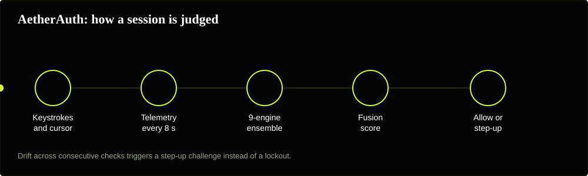

<div align="center">




<br/>

<a href="https://www.linkedin.com/in/harthik"></a> <a href="mailto:harthikanand90@gmail.com"></a> 

</div>


```python
class Harthik:
    role      = "AI/ML Engineer"
    focus     = ["behavioural biometrics", "fraud detection", "risk analytics"]
    building  = ["continuous auth", "zkML on-chain fraud flags", "LLMs from scratch"]
    values    = "fast, reliable, production AI inside real constraints"
    open_to   = "AI/ML Engineer roles in fraud, identity and risk"
```


<div align="center">

   

</div>

| Project | What it does | Stack |
|---|---|---|
| [**AetherAuth**](https://github.com/harctik/behavioral-biometrics) · [live](https://frontend-dun-five-49.vercel.app) | Continuous passive authentication from keystroke, cursor and cognitive signals, with an adaptive step-up challenge | Python, Flask, Next.js, PostgreSQL, Redis, Docker, Helm |
| [**PRAMAANIK**](https://github.com/harctik/pramaanik) · [live](https://pramaanik.vercel.app) | Public fund tracking on a 4-node Besu QBFT chain with RGCN anomaly detection proven on-chain via EZKL and Halo2 | Solidity, Foundry, PyTorch Geometric, Next.js |
| [**PhishGuard**](https://github.com/harctik/PhishGuard) | Manifest V3 extension and FastAPI backend that catches homoglyph and high-entropy phishing domains | Python, FastAPI, Chrome Extension APIs, pytest |
| [**kira.ai**](https://github.com/harctik/kira.ai) | Decoder-only transformer family from scratch (RoPE, GQA, SwiGLU, RMSNorm) with INT8 CPU inference | PyTorch |
| [**QuantRisk**](https://github.com/harctik/Crypto-Investment-Manager) · [live](https://cryptomanagerapp.vercel.app) | Markowitz optimisation, VaR and CVaR, Monte Carlo stress tests and strategy backtests | Python, Flask, SQLite, CoinGecko API |
| [**Studvisor**](https://github.com/harctik/Studvisor) | Academic ERP with role-based access, an attendance amendment workflow and rule-based dropout-risk scoring | FastAPI, React, Alembic |

<div align="center">

<a href="https://github.com/harctik/behavioral-biometrics"></a>
<a href="https://github.com/harctik/pramaanik"></a>
<a href="https://github.com/harctik/PhishGuard"></a>
<a href="https://github.com/harctik/kira.ai"></a>
<a href="https://github.com/harctik/Crypto-Investment-Manager"></a>
<a href="https://github.com/harctik/Studvisor"></a>

</div>




<br/>







<div align="center">


</div>

| | |
|---|---|
| **Languages** | Python · TypeScript · JavaScript · SQL · Solidity |
| **ML** | PyTorch · PyTorch Geometric · scikit-learn · LightGBM · Isolation Forest · Transformers |
| **LLM** | LangChain · LangGraph · Claude API · Gemini API · Arize Phoenix · Qdrant |
| **Backend and infra** | FastAPI · Flask · Docker · Kubernetes · Helm · GitHub Actions · Redis · PostgreSQL |
| **Security** | JWT · CSRF · Fernet · SHA-256 audit chains · entropy and homoglyph analysis |
| **Blockchain** | Hyperledger Besu · Foundry · EZKL · Halo2 |


<div align="center">


</div>

## Terminal

<div align="center"></div>

## Experience

- **Outlier AI**: Generalist AI Contributor (Sep to Nov 2026), model reasoning and instruction-following evaluation
- **Infosys Springboard 6.0**: AI/ML Intern (Feb to Apr 2026), built QuantRisk
- **Zebo.AI with Verzeo**: AI Project Intern (Mar to May 2022), computer vision for fashion classification

## Certifications

Arize AI (LLM Evaluation Basics) · Anthropic (Building with the Claude API) · IBM (Generative AI; Python for Data Science) · Infosys Springboard (Advanced Statistics and Data Mining; DBMS) · EXIN BCS (AI Essentials)


Email [harthikanand90@gmail.com](mailto:harthikanand90@gmail.com) or message me on [LinkedIn](https://www.linkedin.com/in/harthik). Based in Bengaluru, India.

<div align="center">


</div>
