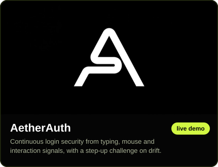
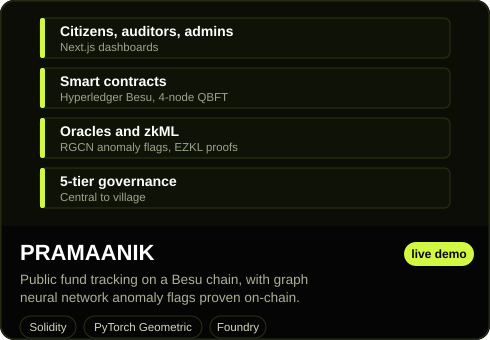
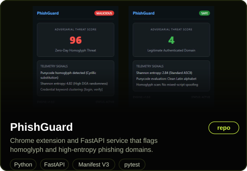
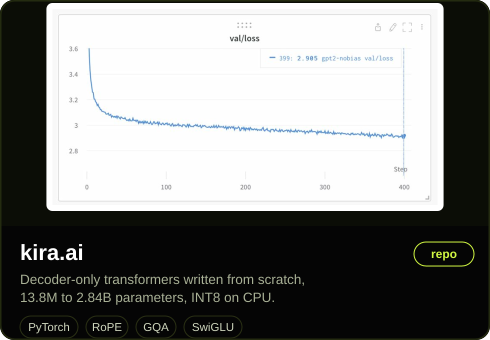
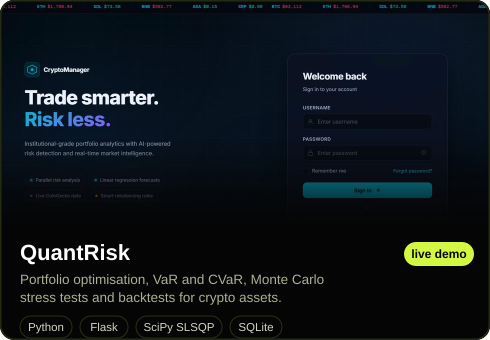
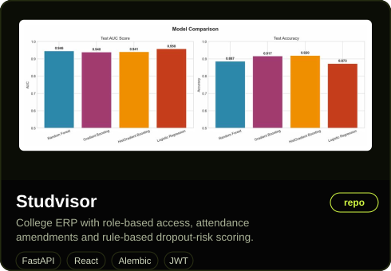

&nbsp;
&nbsp;

  

<table>
<tr>
<td></td>
<td></td>
</tr>
<tr>
<td></td>
<td></td>
</tr>
<tr>
<td></td>
<td></td>
</tr>
</table>

Source: [AetherAuth](https://github.com/harctik/behavioral-biometrics) · [PRAMAANIK](https://github.com/harctik/pramaanik) · [PhishGuard](https://github.com/harctik/PhishGuard) · [kira.ai](https://github.com/harctik/kira.ai) · [QuantRisk](https://github.com/harctik/Crypto-Investment-Manager) · [Studvisor](https://github.com/harctik/Studvisor)

  

 

 

  

 

LLM evaluation (Arize AI) · Claude API (Anthropic) · Generative AI and Python for Data Science (IBM) · Statistics and DBMS (Infosys Springboard) · AI Essentials (EXIN BCS)

